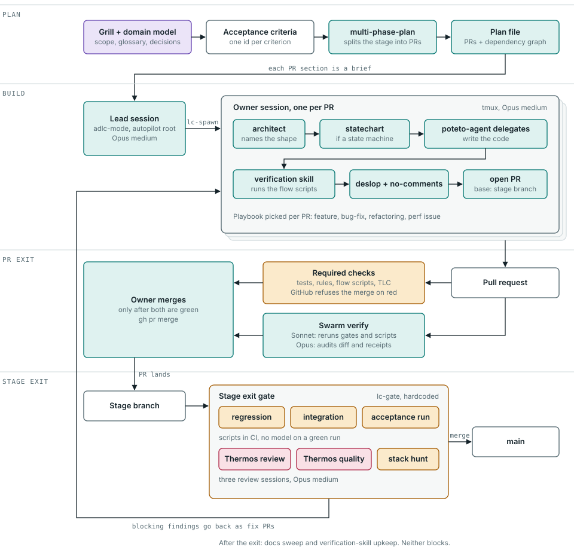
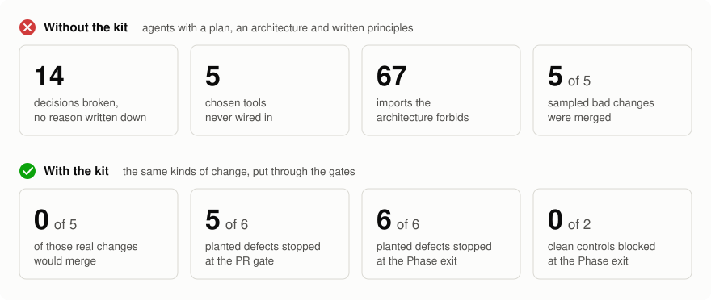

# agent-lifecycle-kit

**Agent-driven development on pstack, with gates.** Coding agents plan, build, verify and merge. The building is done by [pstack](https://github.com/cursor/plugins/tree/main/pstack), used as written: its autopilot gives every pull request one owner from build to merge, and lets nothing merge until agents that wrote none of the code have verified it. This kit is the thin shell around it, an agent-driven development lifecycle (ADLC) that a repository installs. It adds what pstack has none of:

- **A plan step.** The owner and an agent settle scope, vocabulary and acceptance criteria before any code, and the stage is split into pull requests.
- **Sessions and a board.** Each pull request is built by an owner session: a terminal session the owner can watch and message, and one page shows where everything stands.
- **Checks the host enforces.** Tests, exact project rules and scripted end-to-end flows are required checks: no pull request merges while one is red.
- **A stage exit.** A stage is built on its own branch. It enters the default branch only when the whole of it passed the regression runs, a flow script for every acceptance criterion, two independent code audits and a check that the chosen tools were used.

The owner decides; the agents do the rest. The kit knows nothing about any one project: each repository keeps its own values, gate steps included, in `.agents/project.yaml`.



## Proof



One real product was built by agents that had a plan, an architecture and written principles, and they still wrote their own code beside the tools they were told to use. Put through the 1.9 gates, none of those changes would merge. The 2.0 flow has not been through these rounds yet: [method, cases and limits](docs/proof.md).

## What it does, and why

| Step | What happens | Why |
| --- | --- | --- |
| Plan | The owner and an agent turn requirements into stages, each with acceptance criteria. The lead splits a stage into pull requests. | "Done" is written down before any code. |
| Build | pstack's autopilot: one owner session per pull request, which picks the playbook that fits (feature, bug fix, refactoring) and delegates the code. | One job per session, and one way of working that is maintained upstream. |
| PR exit | The host's required checks, then a swarm of verifiers that wrote none of the code. The owner session merges only what both cleared. | An agent cannot call its own work good. |
| Nightly | The full test run on the default branch. | Slow checks still run without holding up every change. |
| Stage exit | Scripts first, then the Thermos audits and the stack review on the whole stage. Each step leaves a record tied to the commit; no record, no merge. | Some defects only show where changes meet, and structure is judged best across a whole stage. |
| Corrections | Every correction (a failed verdict, a review finding, the owner's word) is fixed and then made impossible: architecture, types, a rule whose error names the fix, a test. New code carries no comments. | The codebase is the largest input an agent reads, so it has to hold the rules itself. |

Bake-offs between several designs (pstack's arena and interrogate) run only for a brief the owner marked critical. State machines and concurrent protocols get a model checked by TLC during design, algorithms with a property over every input get a proof (Lean), and screens get property-based tests.

## Install

**Claude Code** (plugin; skills are then named `agent-lifecycle-kit:<skill>`):

```
/plugin marketplace add <path to this clone, or owner/agent-lifecycle-kit>
/plugin install agent-lifecycle-kit@agent-lifecycle-kit
```

**Codex and the shell:** `./install.sh` links the skills into `~/.agents/skills` and `bin/lc-*` into `~/.local/bin`; `--uninstall` removes them. Don't also link the skills into `~/.claude/skills`.

Install alongside it: **pstack** (`/plugin marketplace add cursor/plugins`, `/plugin install pstack@cursor-plugins`), at the version `pstack.lock` pins (`lc-pstack check`), and [mattpocock-skills](https://github.com/mattpocock/skills) for `grilling` and `domain-modeling`. The build runs in Claude Code: pstack has no Codex version.

## A new repository

1. **`bootstrap`** (the skill, in a session in that repository): maps what it already has to the readiness checklist and guides through each open item, including the project's verification skill and its flow scripts. It never overwrites a file.
2. **`lc-gate enforcement`**: one line per gate step and layer, saying who records it, what refuses without it, and whether that is actually on. `--strict` exits 1 when a configured layer is off.
3. **`lc-gate protect`**: prints the branch protection for `ci.required_checks`; `--yes` applies it; `--branch` does the same for a stage branch. It only ever adds.

Per stage: the lead plans, cuts the stage branch and starts an owner session per pull request (`lc-spawn`); owner sessions merge into the stage branch after their verdict; `lc-gate run pr <stage branch> --wait` walks the stage exit (follow-up reviews start by themselves), and `lc-gate merge pr <stage branch>` merges it. Between sessions: `lc-tell`, `lc-log`, `lc-park`. The full list is in [Enforcement](docs/enforcement.md#the-commands).

**Mechanical rules.** What the project decided and a diff can break exactly (who may import a package, which dependencies are allowed, words or files that may not appear) becomes a rule in `.agents/rules.yaml`. Each rule names its written decision and is proved on a red and a green example; `lc-rules check` fails a finding beyond the baseline, and CI judges each change by the base commit's rules. The bootstrap writes the first ones; the stage exit proposes more from findings the reviews keep raising, and the owner decides.

## What enforces what

| Strength | Who | What it refuses |
| --- | --- | --- |
| Host refuses | Branch protection set by `lc-gate protect`, on the default branch and each stage branch | A merge while a required check is red or missing, a push to either branch, administrators skipping either |
| Local hook refuses | The plugin hook | A merge into the default branch without the stage exit's records |
| Independent record | The runner, a CI run, the host's checks or a separate session | A step its author wants to mark done on their own word |
| Owner reads | The owner, in a pull request of its own, for the files in `protected_files` | A change loosening the rules that judge it; CI judges each change by the base branch's copy |
| The playbook's rule | The lead and the owner session, by pstack's autopilot | A merge into a stage branch without the swarm's verdict. No hook reads the verdict |
| Author's own word | Nobody: never a gate step | Nothing; `lc-gate enforcement` flags it |

## What still escapes

- Sessions that share the owner's host login can do whatever the owner can, including changing the protection.
- Records are unsigned files: a session that forges its environment or writes a record by hand is not caught, and a record proves a review ran, not that it was good.
- The hooks hold only where they are installed: the plugin where it is enabled, the git hook where `core.hooksPath` is set.

## More

- [Enforcement](docs/enforcement.md): the model, the modes, the step syntax, the commands
- [Upgrading](docs/upgrading.md): each release since 0.8
- [Machine-specific pieces](docs/machine.md) and the [baseline tools](docs/tools.md)
- [Proof](docs/proof.md): method, cases and limits
- [The lifecycle skill](skills/lifecycle/SKILL.md): steps, roles and gates
- [adlc-mode](skills/adlc-mode/SKILL.md), the fork of pstack's poteto-mode, and [where it differs](skills/adlc-mode/DIVERGENCES.md)
- [The readiness checklist](skills/bootstrap/checklist.md) and [the project file template](templates/project.yaml)
- [License](LICENSE)
