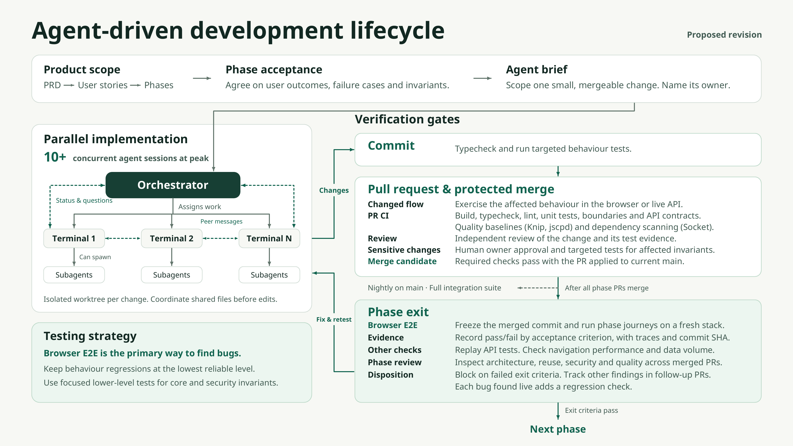

# agent-lifecycle-kit

An agent-driven development lifecycle (ADLC) that a repository installs: a guided setup, gates that refuse a change without its records, and the tools agent sessions use to plan, build, review and merge. The kit knows nothing about any one project; each repository keeps its own values, gate steps included, in `.agents/project.yaml`.



## Install

**Claude Code** (plugin; skills are then named `agent-lifecycle-kit:<skill>`):

```
/plugin marketplace add <path to this clone, or owner/agent-lifecycle-kit>
/plugin install agent-lifecycle-kit@agent-lifecycle-kit
```

**Codex and the shell:** `./install.sh` links the skills into `~/.agents/skills` and `bin/lc-*` into `~/.local/bin`; `--uninstall` removes them. Don't also link the skills into `~/.claude/skills`.

The skills call the [mattpocock-skills](https://github.com/mattpocock/skills) set; install it alongside.

## A new repository

1. **`bootstrap`** (the skill, in a session in that repository): maps what it already has to the readiness checklist and guides through each open item. It never overwrites a file.
2. **`lc-gate enforcement`**: one line per gate step and layer, saying who records it, what refuses without it, and whether that is actually on. `--strict` exits 1 when a configured layer is off.
3. **`lc-gate protect`**: prints the branch protection for `ci.required_checks`; `--yes` applies it. It only ever adds.

## What enforces what

| Strength | Who | What it refuses |
| --- | --- | --- |
| Host refuses | Branch protection set by `lc-gate protect` | A merge while a required check is red or missing, a push to the default branch, administrators skipping either |
| Local hook refuses | The plugin hook and the git `pre-commit` hook | An edit or commit without its plan, a merge without the PR gate's records |
| Independent record | The runner, a CI run, the review pipeline, a separate session or the owner | A step its author wants to mark done on their own word |
| Owner reads | The owner, in a pull request of its own, for the files in `protected_files` | A change loosening the rules that judge it; CI judges each change by the base branch's copy |
| Author's own word | Nobody: never a gate step | Nothing; `lc-gate enforcement` flags it |

## What still escapes

- Sessions that share the owner's host login can do whatever the owner can, including changing the protection.
- Records are unsigned files: a session that forges its environment or writes a record by hand is not caught, and a record proves a review ran, not that it was good.
- The hooks hold only where they are installed: the plugin where it is enabled, the git hook where `core.hooksPath` is set.

## More

- [Enforcement](docs/enforcement.md): the model, the modes, the step syntax, the commands
- [Upgrading](docs/upgrading.md): 0.8 to 1.0, 1.0 to 1.1, and 1.1 to 1.2
- [Machine-specific pieces](docs/machine.md)
- [Proof (in progress)](docs/proof.md)
- [The lifecycle skill](skills/lifecycle/SKILL.md): steps, roles and gates
- [The readiness checklist](skills/bootstrap/checklist.md) and [the project file template](templates/project.yaml)
- [License](LICENSE)
