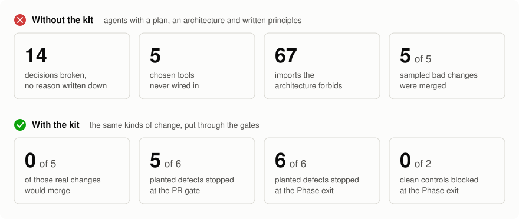

# Proof: what agents built without the kit, and what the kit catches

Numbers and case shapes only. This is work in progress: more red-team rounds follow, and each one feeds the gates.

## Without the kit

One real TypeScript product, built by coding agents over about two months. The agents had what is usually called enough:

- a product requirements document and written user journeys;
- an architecture with a register of chosen tools, one per job;
- principles in the agent instruction files, read at the start of every session;
- a review on every pull request.

An audit of the code against that register found:

| | Count |
| --- | --- |
| Places where the code went against a decision, with no reason written down | 14 |
| The same, with a reason but no decision record | 1 |
| Tools that were decided and never wired in | 5 |

The shapes repeat. The agents wrote their own code where a chosen tool already did the job:

- a scheduler, a lease and a heartbeat written beside the chosen durable runtime;
- a schema builder and validators written by hand beside the chosen schema library;
- the query builder used only to run hand-written SQL;
- the web framework kept as a shell around hand-built routing and guards;
- a custom import-boundary checker beside the monorepo tool, which missed its own main rule.

The first exact rules, run on the same code, counted 67 imports from the kernel into feature packages, 8 routes missing from the API contract, 36 internal words in text a person sees, and 4 stray reads of the environment.

Every one of these changes was merged. Each looked reasonable on its own, and its description said it followed the architecture.

## With the kit

**Real history, replayed.** Five of those real merged changes were put through the gates as if new. None would merge. The PR review and the Phase exit refused all five; the mechanical rules alone refused four.

**Planted defects.** A red-team session wrote small branches, each with one planted defect and an honest-looking description, plus clean controls. It never saw the gates. Judges never saw the answer key, and no review question was written to match a planted case. On a set kept apart from all tuning:

| | Result |
| --- | --- |
| Planted defects stopped by the PR gate | 5 of 6 |
| Planted defects stopped by the Phase exit | 6 of 6 |
| Clean controls blocked by the Phase exit | 0 of 2 |

Shapes of the planted defects: a second path to an effect without the first path's checks; stored data trusted without its schema check; a state with no way out after a failure; a retry after an unknown outcome; a platform guarantee rebuilt by hand; a retry loop beside the chosen durable runtime.

**A fresh install.** On a new project set up only through the wizard, the gates judged all three test changes correctly: a forbidden import, a false README, and a clean change.

## Limits

- Small numbers, one run each: this shows direction, not a rate.
- False refusals exist: in the replay the clean control was refused by the mechanical rules, and one clean control was held by the PR review.
- Judges were short reviewers that opened few files and ran nothing.
- Refusing a change needs a CI host; without one the gates detect and report only ([issue #2](https://github.com/ydgmngmt/agent-lifecycle-kit/issues/2)).
- Not covered yet: the live check, the built-as-described and docs sessions, the owner's acceptance.
